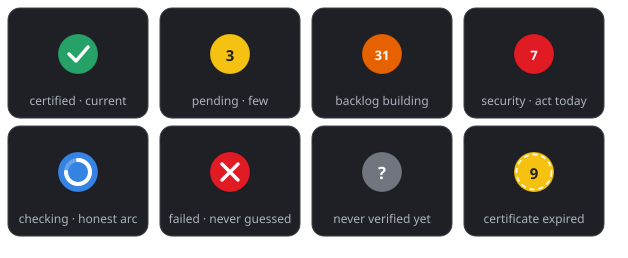
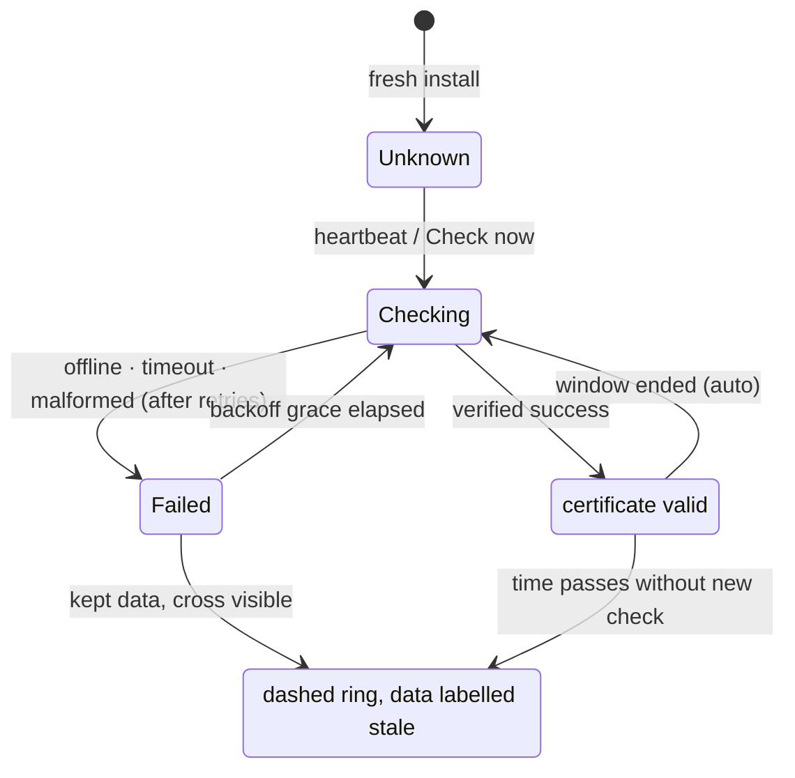
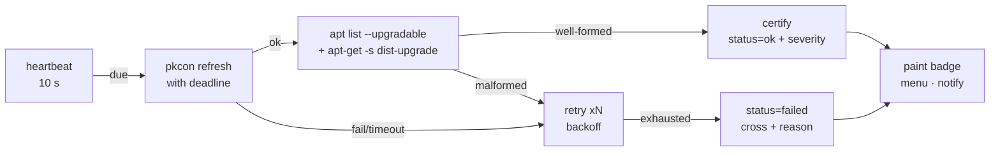

<div align="center">

# Update Watch

**A decide-yourself update indicator for GNOME Shell.**

*The badge is a certificate — green only after a verified, successful check.
Nothing ever downloads or installs without your click.*

[](LICENSE)
[](#supported-sessions)
[](https://github.com/88888Z/update-watch/releases)
[](#the-truth-protocol)



</div>

---

## Why

Most update checkers either nag you, act behind your back, or hide the one bit
you care about — *has my system drifted?* — behind an app you must keep opening.

Update Watch puts one small, painted line of truth in the panel:

- **Green** — the system is verified current. Satisfying.
- **Yellow / Orange** — updates exist (few → backlog). Your move.
- **Red** — a security update landed. Act today.
- **Blue wheel** — a check is running *right now*, with a phase-true progress arc.
- **Cross / ? / dashed** — failure, never verified, expired certificate. No pretending.

> [!IMPORTANT]
> Checks are **metadata-only** (`pkcon refresh` + `apt` parsing) and happen
> entirely inside the shell process. There is no daemon, no root, no systemd
> unit, no network call of its own — and no code path that installs anything.

## The states

| badge | when | what it promises |
|-------|------|------------------|
| ● green tick | verified up-to-date | a real check finished cleanly within the certificate window |
| ● yellow **n** | 1–24 normal updates | data from your last *verified* check |
| ● orange **n** | 25+ pending (threshold tunable) | a backlog is building |
| ● red **n** | any `*-security` origin pending | highest priority, shown regardless of total |
| ● blue wheel | check in flight | honest phase-stepped arc, never a fake sweep |
| ● red ✕ | last attempt failed | no connection / timeout / broken repo / malformed output — the menu names it |
| ● grey **?** | never verified yet | no certificate exists — first check will fix that |
| ⟡ dashed ring | certificate **expired** | the data shown is older than your window until a new check succeeds |

## Install

```bash
git clone --depth 1 https://github.com/88888Z/update-watch.git
cd update-watch && ./install.sh
```

Look at your top bar. That's it.

<details>
<summary>Alternative: GNOME-native package install</summary>

```bash
make pack                    # -> dist/update-watch@rich.shell-extension.zip
gnome-extensions install dist/update-watch@rich.shell-extension.zip
```

</details>

<details>
<summary>X11 one-time tip: if the badge doesn't appear live</summary>

```bash
./install.sh --reload        # or: killall -3 gnome-shell
```

On Wayland the badge appears on your next login (extensions are scanned at
session start); on X11 the in-place reload is instant and your apps survive.

</details>

<details>
<summary>Uninstall</summary>

```bash
make uninstall
```
Removes only the extension — packages, apt state and your system stay untouched.
The installer also absorbs and archives any legacy external watchdog (systemd
timer / bash scripts) into `legacy/` automatically.

</details>

## The truth protocol

Four rules, enforced in code:

1. **Verified-only green.** The tick exists *only* after a fully successful
   pipeline: metadata refresh returns success **and** the apt scan produces a
   well-formed result. Any other outcome — offline, timeout, broken repo,
   missing output — is a different state, never a hopeful green.
2. **Certificates expire.** A check is valid for the *certificate window*
   (default 4 h). After that the badge keeps telling the truth — same data,
   dashed ring — until a new check re-certifies.
3. **Failures are named.** The ✕ state persists with the exact reason in the
   menu (`timeout (120s per step)`, `pkcon refresh failed`, …) between
   configurable retries, and never notifies — the badge *is* the notification.
4. **Unknown is known.** A fresh install shows **?** until the first verified
   check; pre-v5 state files are treated as uncertified and re-checked.



## Severity ladder

| origin | badge color | rule |
|--------|-------------|------|
| security suite (`*-security`) | 🔴 red | always wins — even a single package |
| 25+ pending (default) | 🟠 orange | tunable threshold |
| 1–24 pending | 🟡 yellow | normal cadence |
| none | 🟢 green | certified current |

Security origins are detected by simulating the upgrade
(`apt-get -s dist-upgrade` — `-s` can never change your system) and matching
packages landing from security pockets.

## Tunables — everything, nothing hardcoded

Right-click the badge → **Preferences**, or
`gnome-extensions prefs update-watch@rich`.

| setting | default | range | meaning |
|---------|---------|-------|---------|
| auto-check | on | — | heartbeat re-verification every 10 s |
| certificate window | 240 min | 30 m – 24 h | a check certifies the state only this long |
| per-step deadline | 120 s | 10 – 600 s | every pipeline step must finish, else honest failure |
| attempts per check | 2 | 1 – 5 | retries with backoff, then the ✕ |
| delay between retries | 30 s | 5 – 300 s | backoff knob |
| orange threshold | 25 | 5 – 200 | severity split (security always red) |
| notification on updates | on | — | failures never notify |
| pulse while pending | on | — | disable if the breathing is too loud |

<details>
<summary>Power users: the state file</summary>

`~/.local/share/apt-watch-state` — plain `key=value`, written atomically,
single-writer, orphan-tolerant:

| key | role |
|-----|------|
| `status` | `ok` / `failed` / empty (never verified) |
| `checked_epoch` | completion of the last verified check |
| `count` / `top` / `security` / `sec_top` | severity data of that check |
| `fail_reason` / `fail_epoch` | why the last attempt failed |
| `phase` / `pct` | in-flight check telemetry for the spinner |

</details>

## How it works



All subprocesses are async (`Subprocess.wait_check_async`,
`communicate_utf8_async`) with hard deadlines and clean teardown — the
compositor never blocks. The badge glyphs are **Cairo-painted**
(`vfunc_repaint`), so they render identically on every theme, icon set and
accent color.

## Supported sessions

- GNOME Shell **45 – 49**, Wayland and X11 (tested on GNOME 48.7 / Debian 13)
- Debian-family distros using `apt` + PackageKit; Fedora/Arch ports welcome
  (the checker is two well-defined shell-outs)

## Project layout

```
update-watch/
├── update-watch@rich/       the single installable artifact
│   ├── extension.js         badge + async truth pipeline
│   ├── prefs.js             Adw preferences (ExtensionPreferences API)
│   ├── schemas/             GSettings schema (all tunables)
│   └── metadata.json
├── docs/banner.svg          the badge gallery
├── install.sh · uninstall.sh · pack.sh · Makefile
├── legacy/                  archived pre-1.0 watchdog (history)
├─ LICENSE (MIT)
```

## Contributing

One idea per PR, clean diffs over clever ones, and test on your own session
before proposing the change. Translations are welcome — all strings already
route through `gettext`. Bump `version` in `metadata.json` with breaking
changes; `make pack` must stay reproducible.

> [!TIP]
> Porting to a non-Debian OS? Open an issue with your state file attached
> (`cat ~/.local/share/apt-watch-state`) — it's a 10-line diagnosis for most
> environments.

## License

MIT — see [LICENSE](LICENSE).
Built the hacker way, against the shell's own source as documentation.

The most honest square meter of your panel has a changelog now.
